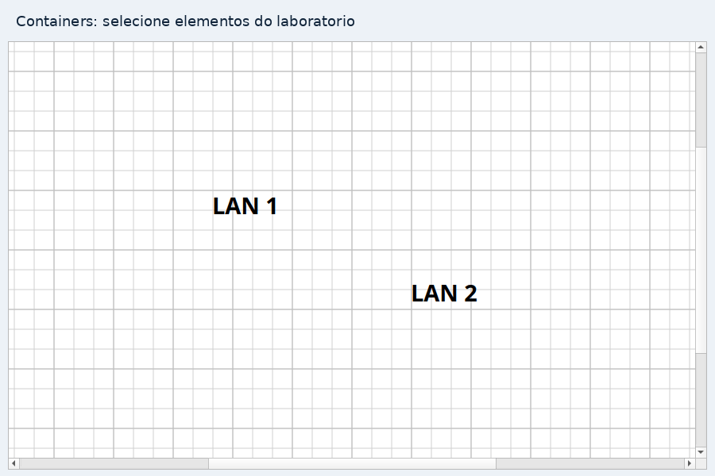
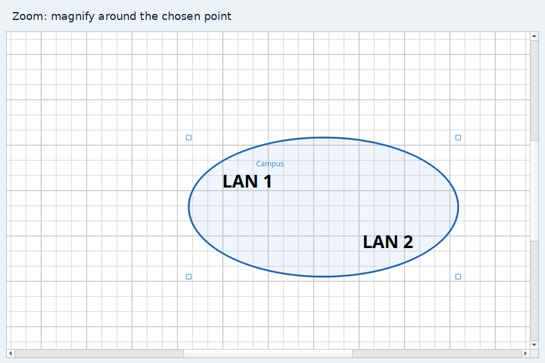
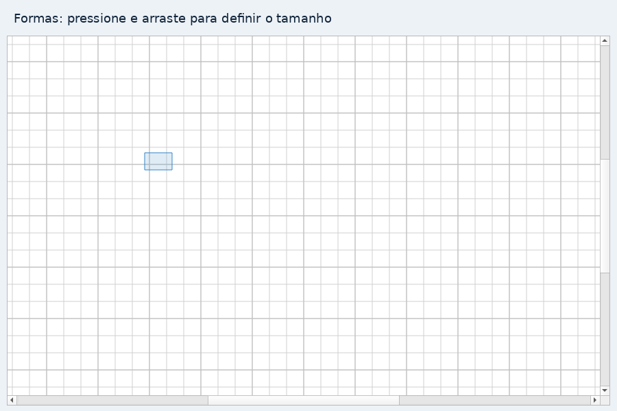
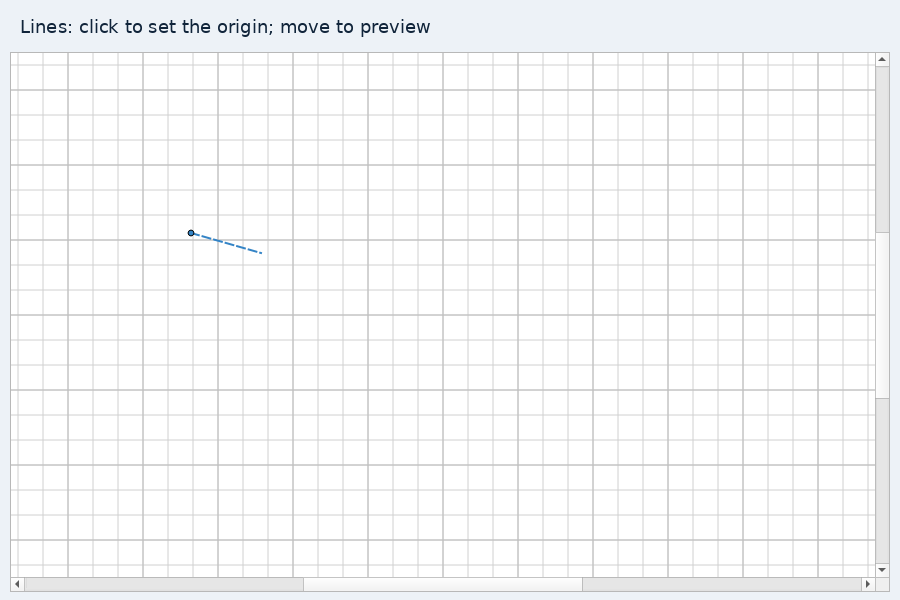
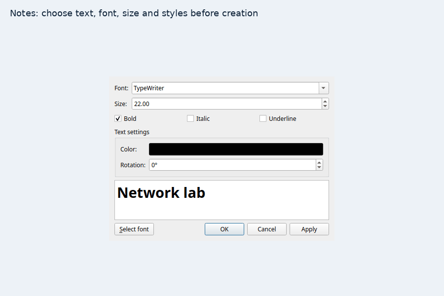
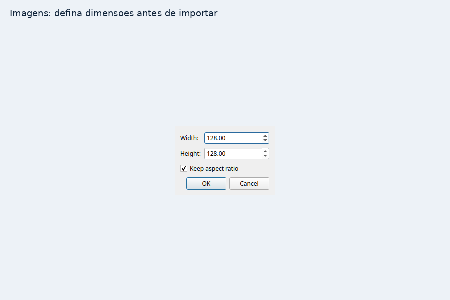
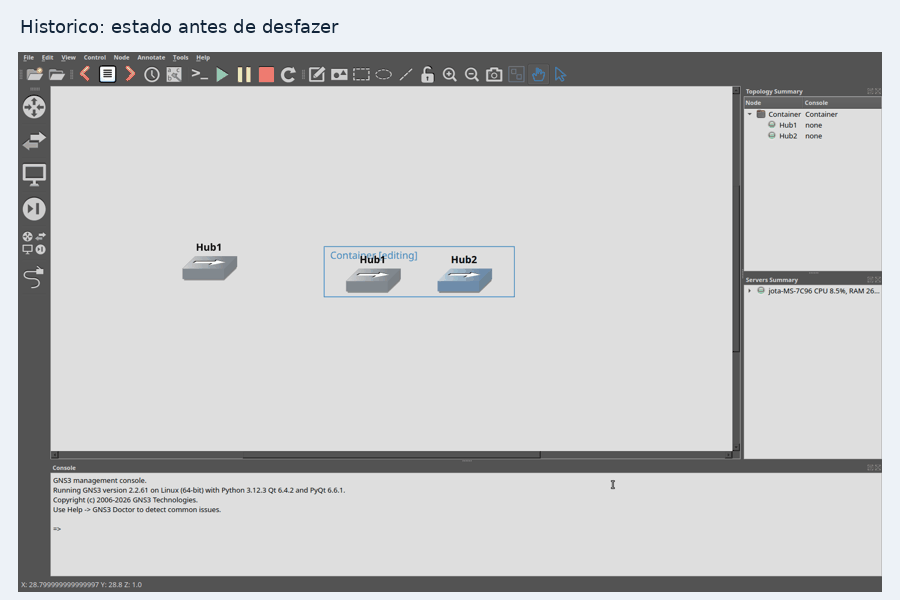

# GNS3 GUI Fork — um canvas mais completo para seus laboratórios

Organize topologias em **containers aninhados**, desenhe e anote com mais controle e navegue pelas alterações com **Undo, History e Redo persistentes**.

Este é um fork comunitário de [GNS3/gns3-gui](https://github.com/GNS3/gns3-gui), baseado no GNS3 GUI **2.2.61**, com foco na criação e organização visual de laboratórios de rede. O GNS3 permite montar topologias com dispositivos virtuais; este fork amplia a experiência de edição da interface gráfica.

> **Desenvolvido com auxílio do OpenAI Codex.** O fork utilizou Codex para facilitar a investigação do código, a implementação das funcionalidades, a criação de testes, a análise de regressões e a documentação. O projeto original e seus autores continuam sendo a base deste trabalho. Este fork é independente do GNS3 e da OpenAI.

[Experimentar](#experimentar-o-fork) · [Funcionalidades](#funcionalidades-em-ação) · [Documentação técnica](#documentação-e-validação) · [Contribuir](#contribuir-e-divulgar)

## O que muda neste fork

| Recurso | O que você pode fazer |
| --- | --- |
| Containers persistentes | Organizar dispositivos e desenhos em hierarquias, mover conjuntos e personalizar suas molduras. |
| Hand e seleção retangular | Navegar arrastando o canvas e selecionar áreas com o botão direito. |
| Zoom no cursor | Aproximar exatamente a região apontada, com passos menores. |
| Retângulos e elipses por arraste | Definir a área antes de confirmar cores, dimensões e bordas. |
| Linhas por dois cliques | Escolher as duas pontas, prever o traçado e editar suas extremidades. |
| Notas com tipografia | Escolher fonte, tamanho, cor e estilos antes de criar a anotação. |
| Imagens redimensionáveis | Configurar proporção e dimensões, ajustar pelas bordas e importar imagens grandes. |
| Histórico persistente | Desfazer/refazer ações e recuperar o histórico ao reabrir o projeto. |

As novidades estão reunidas na branch **`codex/canvas-all-improvements`**. A branch `master` deste repositório mantém a base upstream e não contém esse conjunto de funcionalidades. Os exemplos abaixo se referem à branch completa.

## Funcionalidades em ação

Os GIFs são demonstrações curtas. Containers, navegação, formas, linhas, notas e imagens foram capturados em widgets reais do Qt, em ambiente offscreen com transporte simulado, sem executar appliances. O GIF de histórico é uma sequência de capturas dos testes nativos com servidor real. [Origem e reprodução das demonstrações](docs/media/README.md).

### Containers: organize a topologia por contexto



1. Selecione dispositivos, notas, imagens ou desenhos do mesmo nível e pressione **Ctrl+G**, ou use **Container elements** na barra.
2. Dê um nome ao conjunto e ajuste suas dimensões. Crie novos containers sobre conjuntos existentes para montar uma hierarquia.
3. Arraste um container fechado para mover seus filhos juntos. Dê **duplo clique no corpo** ou use **Enter container** para editar o conteúdo; **Esc** encerra a edição.
4. Use as propriedades e a aba **Style** para escolher retângulo, triângulo ou elipse, preenchimento, cor e borda. **Apply** mostra uma prévia; **OK** confirma e **Cancel** restaura o estado anterior.
5. Redimensione pelos quatro cantos. Arraste dispositivos para dentro ou para fora para alterar a associação. **Ctrl+Shift+G** dissolve o container preservando seus filhos.

A árvore **Topology Summary** acompanha a hierarquia. Duplicar copia a árvore e recria os links internos; links para dispositivos externos permanecem no original. Nomes, estilo e associações acompanham o projeto salvo e sua exportação portátil.

Containers têm dimensões fixas: mover filhos não expande automaticamente a moldura. Retângulos podem recortar conteúdo fora dos limites; trocar a forma ajusta os filhos para caberem, podendo ampliar a moldura. [Guia completo](docs/canvas-grouping.md) · [Aparência e edição](docs/canvas-authoring.md).

### Navegação: mão, seleção e zoom no cursor



- **Hand** é o modo inicial: arraste uma área vazia com o botão esquerdo para navegar. Arrastar um elemento continua movendo o elemento.
- **Botão direito + arraste** seleciona uma área e abre as ações da seleção, incluindo **Create container**. **Ctrl** permite adicionar outra área à seleção. Um clique direito sem arraste abre o menu de contexto.
- **Ctrl + roda do mouse** amplia ou reduz ao redor da posição atual do cursor. Cada passo convencional aproxima cerca de 9%, dentro dos limites de 10% a 1000%.

A navegação não altera as coordenadas dos dispositivos. [Detalhes do zoom](docs/cursor-zoom.md) · [Gestos de navegação](docs/canvas-authoring.md#navegação-e-seleção-com-o-mouse).

### Formas: desenhe na dimensão desejada



Ative **Rectangle** ou **Ellipse**, pressione no canvas e arraste. Ao soltar, o editor permite confirmar dimensões, preenchimento, cor, espessura e estilo de borda. Espessura zero permite uma forma sem borda. **Esc** cancela o rascunho; cancelar o editor descarta a criação. [Como funciona](docs/canvas-authoring.md#formas-por-arraste).

### Linhas: dois cliques e pontas editáveis



Ative **Drawn line**, clique para marcar a origem, mova o cursor para ver a prévia e clique novamente para definir a outra ponta. Em **Line properties**, escolha cor, opacidade, espessura e traço contínuo, tracejado ou pontilhado. **Apply** permite pré-visualizar antes de confirmar.

Após criar, mova pelo corpo da linha ou selecione e arraste uma das pontas. **Esc** cancela uma criação em andamento. Essas linhas são desenhos visuais; conexões entre dispositivos continuam usando a ferramenta de links. [Guia das linhas](docs/feature-line.md).

### Notas: tipografia antes de confirmar



Ative a criação de notas e clique no canvas. O editor oferece texto, família da fonte, tamanho, negrito, itálico, sublinhado e cor, com prévia. Fontes já utilizadas no projeto aparecem com prioridade. **OK** cria uma nota não vazia; cancelar descarta o rascunho.

As fontes não são incorporadas ao projeto: outro computador pode usar uma substituta se a família não estiver instalada. [Detalhes das notas](docs/canvas-authoring.md#notas-com-tipografia-na-criação).

### Imagens: controle de tamanho e proporção



Ao importar, ajuste largura e altura em **Image properties**. **Keep aspect ratio** sincroniza as dimensões; desmarque para defini-las independentemente. Depois, selecione a imagem e arraste uma borda ou canto para redimensionar; pelo interior, você move a imagem. O GIF mostra o diálogo e uma sequência de dimensões aplicadas no canvas.

O tamanho e a preferência de proporção ficam no SVG. O redimensionamento reutiliza a imagem decodificada durante o gesto para reduzir travamentos. Imagens cujo SVG excede o limite do JSON são enviadas como recursos do próprio projeto, sem compressão com perdas e sem exigir aumento do limite do servidor. [Guia de imagens e upload](docs/canvas-authoring.md#imagens-dimensões-iniciais-e-redimensionamento).

### Histórico: desfaça, refaça e continue após reabrir



Use **Undo**, **History** e **Redo** na barra, ou **Ctrl+Z** e **Ctrl+Y** com foco no canvas. No diálogo **History**, selecione uma entrada para percorrer os estados. Campos de texto e notas em edição conservam seus atalhos nativos.

O histórico reúne alterações de dispositivos, links, desenhos e containers em operações lógicas e mantém até **100 operações por projeto**. É armazenado nos arquivos do projeto, permitindo continuar após reabertura e acompanhar a exportação portátil quando as identidades puderem ser remapeadas com segurança. Uma nova edição depois de Undo descarta o futuro disponível para Redo.

**Limite importante:** Undo recupera definições de topologia e conexões, mas não recupera discos, configurações internas ou arquivos de appliances removidos pelo compute. Use snapshots e backups para esses dados. Comandos de console, ligar/desligar e snapshots não entram nesse histórico. Alterações externas incompatíveis podem bloquear a navegação; na reabertura, os registros incompatíveis são preservados antes de iniciar uma nova sequência. [Uso, persistência e recuperação](docs/history/README.md).

## Experimentar o fork

Exemplo para Linux com Python **3.9 ou superior**, `git` e suporte a ambientes virtuais:

```bash
git clone --branch codex/canvas-all-improvements https://github.com/redlintles/gns3-gui-fork.git
cd gns3-gui-fork
python3 -m venv .venv
.venv/bin/python -m pip install --upgrade pip
.venv/bin/python -m pip install PyQt6 -e .
.venv/bin/python -m gns3.main --profile canvas-fork
```

O perfil `canvas-fork` separa as preferências da GUI; os projetos pertencem ao servidor escolhido. Experimente em um projeto de teste ou cópia de um laboratório.

Você também precisa de um **GNS3 Server instalado e configurado separadamente**. As integrações deste fork foram verificadas com o servidor **2.2.61**, sem modificações obrigatórias no servidor. Use o assistente ou as preferências da GUI para configurar a conexão. Instalar `gns3-gui` do PyPI não instala as alterações deste fork.

Conforme seu laboratório, instale um terminal e cliente Telnet, cliente VNC ou SPICE e Wireshark para captura de pacotes. Imagens de sistemas e appliances são obtidas separadamente. Para configuração geral e outros sistemas operacionais, consulte a [documentação do GNS3](https://docs.gns3.com/).

Uma GUI upstream pode abrir dispositivos e desenhos nas posições absolutas, mas não oferece a semântica dos containers deste fork. Evite alternar clientes ao editar hierarquias sem antes fazer uma cópia do projeto.

## Documentação e validação

Os guias acima descrevem uso e limites. Para investigar a implementação:

- [Histórico: arquitetura, persistência e testes com servidor](docs/history/README.md)
- [Containers: representação SVG, hierarquia e integração](docs/canvas-grouping.md)
- [Criação visual: formas, notas, imagens e navegação](docs/canvas-authoring.md)
- [Auditoria: correções e evidências de validação](docs/audit/FINDINGS_AND_FIXES.md)
- [Investigação de visibilidade e vida útil dos itens](docs/history/CONTAINER_VISIBILITY_INVESTIGATION.md)
- [Investigação de rastros visuais em Undo/Redo](docs/history/CONTAINER_REPLAY_GHOST_INVESTIGATION.md)

Para executar a suíte automatizada:

```bash
.venv/bin/python -m pip install -r dev-requirements.txt
QT_QPA_PLATFORM=offscreen .venv/bin/python -m pytest -q
```

Na validação desta atualização de documentação, a suíte completa terminou com **594 testes aprovados e 2 ignorados**, em Qt offscreen. Os relatórios registram o ambiente, os resultados e as limitações de cada validação. Testes de integração em `scripts/check_*.py` têm requisitos próprios; consulte os guias e use um servidor descartável.

Para alterar interfaces Qt Designer, edite os arquivos `.ui` e regenere os bindings:

```bash
cd scripts
python3 build_pyqt.py
```

Inicie a GUI com `--debug` para obter logs detalhados; o shell interno também aceita `debug 2`.

## Contribuir e divulgar

Experimente as funcionalidades, compartilhe os GIFs e conte como o fork ajudou a organizar seu laboratório. Uma estrela no repositório ajuda outras pessoas a encontrar o projeto.

Para relatar problemas, [abra uma issue neste fork](https://github.com/redlintles/gns3-gui-fork/issues) com branch/commit, sistema operacional, versões de GUI e servidor, passos de reprodução e, quando possível, um projeto mínimo sem dados sensíveis. Para propor mudanças, consulte [CONTRIBUTING.md](CONTRIBUTING.md) e abra o PR neste fork; contribuições ao upstream seguem o processo dos mantenedores do GNS3.

## Créditos e licença

GNS3 GUI é trabalho dos [autores originais](AUTHORS) e da comunidade [GNS3](https://github.com/GNS3/gns3-gui). As extensões deste fork foram desenvolvidas com auxílio do **OpenAI Codex**, incluindo implementação, testes e documentação.

O código mantém a licença [GNU GPL v3 ou posterior](LICENSE). Para vulnerabilidades, consulte a [política de segurança](SECURITY.md).
